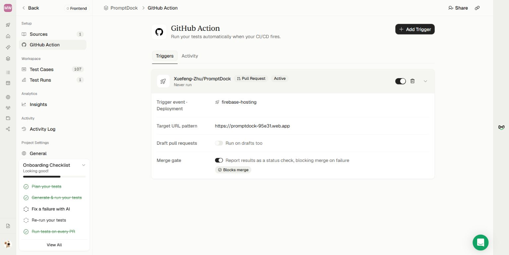

# TestSprite setup and first run — October 22, 2026

## Deployment and integration

- Fix PR: https://github.com/Xuefeng-Zhu/PromptDock/pull/201 — merged into `develop`, commit `82bcafe24790ba20b26afee5348cf2335338b4b3`.
- Production: https://promptdock-95e31.web.app. Authorized manual dispatch from `develop` succeeded: https://github.com/Xuefeng-Zhu/PromptDock/actions/runs/39863759026. `main` was not moved. Lint, Vitest and build passed in that deployment; the same commit also passed full browser/native CI.
- Live regression verification: inspector values `constructor=Ada`, `__proto__=literal $& 中文 😀` rendered and copied exactly `Use Ada and literal $& 中文 😀.` without crashing.
- Portal project: https://www.testsprite.com/dashboard-v3/o/xuefeng-zhus-workspace-6167b83c/projects/43ae1231-cf5e-4d9a-81ee-e93fdf6dcf28/test-cases.
- The anonymous frontend project uses the production URL and the prepared scope. No Firebase test credentials, sync/workspace testing, secret values, or paid upgrade were added.
- GitHub integration initially reported that it could not access the repository despite an all-repository installation. Reconnecting and explicitly selecting **PromptDock** in the installation resolved event discovery. The installation is now scoped to PromptDock.
- Active pull-request trigger: successful deployment event for environment `firebase-hosting`; target `https://promptdock-95e31.web.app`; draft PR runs off; Merge gate on (`Report results as a status check, blocking merge on failure`).
- The preview workflow runs for same-repository PRs into `develop`, excluding forks and Dependabot. These exclusions limit which PRs can trigger through this deployment event.
- **Frank selected the production target for the deadline.** Firebase preview URLs include an unpredictable suffix; the portal supports only `{pr}`, `{branch}`, `{branch-slug}`, `{sha}`, `{short-sha}` in a URL pattern. Preview deployment is the trigger signal, but the test target remains production. This does not validate unmerged PR code.
- A real TestSprite PR status/comment and required-check enforcement in GitHub still need verification. No merge protections were bypassed. No Discord submission was posted.

## First portal run

Run: https://www.testsprite.com/dashboard-v3/o/xuefeng-zhus-workspace-6167b83c/projects/43ae1231-cf5e-4d9a-81ee-e93fdf6dcf28/execution/cb159b2b-f603-47c6-b732-8416d5625ea5

**107 cases across 13 use cases: 57 passed, 21 failed, 29 blocked.** This is not a passing suite or submission-ready evidence. Exploration began while deployment was finishing, so some generated assumptions describe the previous production UI. The test run itself began after deployment succeeded.

Initial triage from test plans and failure observations:

| Case | Observation | Classification / next action |
| --- | --- | --- |
| Browse seeded library views | Favorites, Recent and Archived are selected, but the heading remains All Prompts. | Confirmed app defect: `LibraryHeader` hardcodes All Prompts. Prepared local view-heading fix with component and browser regressions. |
| Recover from empty search results; Mobile search filters the prompt list | Search field appears empty but the library remains filtered. | Needs replay and live reproduction; header search and palette maintain distinct queries. Do not relax recovery assertions. |
| Save a template prompt with metadata and copy the rendered output | Expects inspector Copy to disable for missing values. | Incorrect surface: missing-value validation belongs in the fill modal, while inspector Copy can copy unresolved template text. Correct the steps to open the fill modal and retain the disabled-Copy assertion there. No test has been weakened or removed. |
| Prevent constructor and proto placeholder regression | Save/reload and exact preview pass; clipboard text could not be independently verified from visible UI. | Automation gap: retain exact clipboard assertion and add a verifiable read/paste step. The live Chrome clipboard check passed independently, which does not replace this portal assertion. |
| Handle constructor and proto variable names safely | Resolved output works without crashing; test expects inspector Copy disabled when empty. | Correct the validation surface to the fill modal; retain empty-value rejection and exact-output requirements. |
| Render literal special characters in a template prompt | Generated body already substitutes the topic literal, then tries to fill a nonexistent topic input. | Invalid generated test data: restore `Write {{topic}} in {{tone}}. Repeat: {{topic}}.` as the body, then fill topic/tone. Preserve literal-output assertions. |
| Export active prompts to JSON | Export clicked; runner could not inspect downloaded JSON or native save picker. | Automation blocker. Download/picker handling and JSON assertions must be completed; a toast alone is not sufficient. |
| Mobile search filters the prompt list | Run Settings inherited 1920×1080 despite a mobile step. | Configure an actual mobile viewport and assert innerWidth; do not count desktop execution as mobile coverage. |

The remaining failures/blocked cases need individual review before a green result can be claimed. No failing test has been skipped, disabled, deleted or softened to obtain a green result.

## Submission gate

1. Publish the prepared heading fix only with Frank's approval; get normal CI green, merge, and deploy with approval.
2. Correct inaccurate generated setup/interaction steps while preserving the intended assertions; handle clipboard/files and actual mobile viewports.
3. Re-run all cases. Investigate app defects and genuine runner blockers rather than accepting unchecked assertions.
4. Exercise the GitHub trigger and obtain an actual passing TestSprite comment/status on a PR. Verify that failure holds the merge through required checks.
5. Update the Discord draft with the verified result, PR, and confirmed TestSprite account details; Frank posts it before the deadline.
