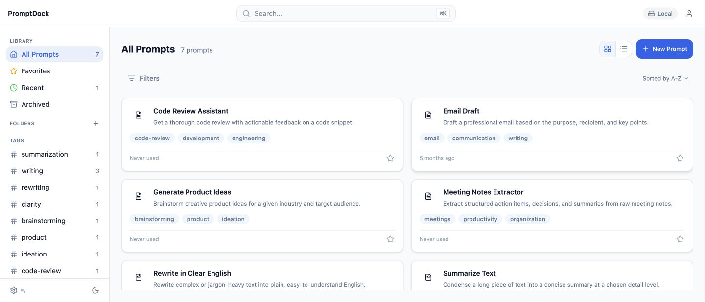
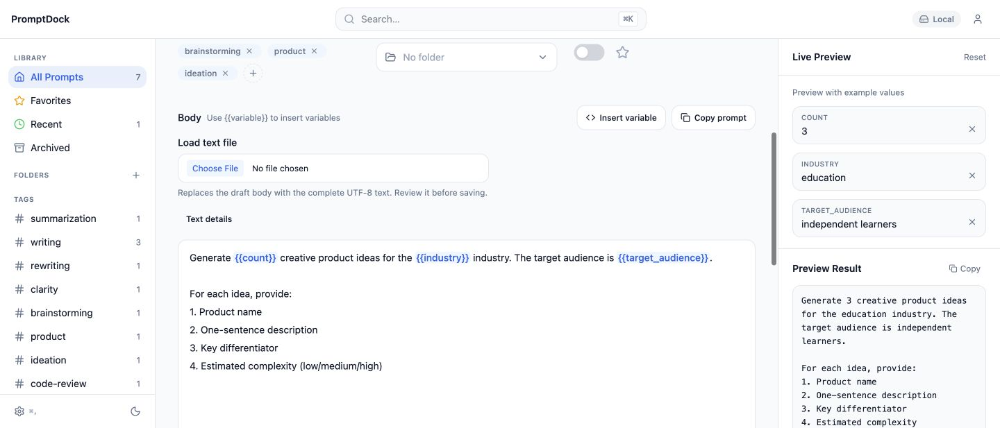

# PromptDock — TestSprite Hackathon Season 4 submission

## Published entry — October 24, 2026

**[Open the Discord submission](https://discord.com/channels/1227394620623949934/1563612968724209664).** The entry titled **PromptDock — Local-first prompt recipes with exact variable output** was posted by `frankzhu94` on October 24, 2026 at **10:59 AM Pacific**, with two real app screenshots. Publication was verified through Discord's Post created notification and readback of the full message and both attachments.

The entry describes the user problem, a one-minute walkthrough, the TEM-005 bug and fix, coverage, and current runner limitations. It explicitly reports **91 Passed / 2 Failed / 14 Blocked** as the latest result per case across focused runs, and says no green full-suite TestSprite PR result exists. The required account information was included in the approved Discord entry; the account email is omitted from this repository.

| Item | Verified checkpoint |
|---|---|
| Live browser app | [promptdock-95e31.web.app](https://promptdock-95e31.web.app), anonymous local mode |
| Repository and PR | [PromptDock](https://github.com/Xuefeng-Zhu/PromptDock), [PR #202](https://github.com/Xuefeng-Zhu/PromptDock/pull/202), base `develop`, open/unmerged |
| Production and remote PR head | `22647ec76670ae7401148f9cb6208c1982c681cb`; [production deployment succeeded](https://github.com/Xuefeng-Zhu/PromptDock/actions/runs/40074130187) |
| Ordinary CI | [Build and test passed](https://github.com/Xuefeng-Zhu/PromptDock/actions/runs/40073649533); PR preview and CodeQL checks also passed at that head |
| TestSprite inventory | **107 cases / 217 assertions; 91 Passed / 2 Failed / 14 Blocked; 0 running**, refreshed October 24 |
| Latest focused run | FLT-011, ONB-002 and FAV-014: [3 Passed / 0 Failed / 0 Blocked](https://www.testsprite.com/dashboard-v3/o/6167b83c-97c5-5141-8f17-545913fba1fa/projects/43ae1231-cf5e-4d9a-81ee-e93fdf6dcf28/execution/db9cdc55-47a7-451b-9b78-800da332b0c3) |
| Automatic PR testing | Paused during investigation; required **Build and test** and **TestSprite V3** checks remain |
| Submission media | Two screenshots attached; no demo video published as part of this submission |

Posting the entry is complete. Passing a complete TestSprite PR run and merging the PR remain separate engineering follow-ups.

## Local execution-obstacle correction — pending deployment

Account → Layout details now provides actual numeric viewport and overflow measurements in the local candidate. [Investigation and verification](evidence/runner-obstacle-investigation.md) and the [pending TEM-010 action patch](evidence/testsprite-layout-pending.yaml) explain the correction. The patch preserves both original assertions and is not saved in TestSprite. Production, remote PR head and portal verdicts above remain the recorded submission checkpoint; this local correction has not been pushed or deployed. The remaining JSON/download cases still require supported runner file access.

## Submission screenshots

These are the two screenshots attached to the published entry. Both show synthetic sample recipes in the deployed browser app, without private prompts or account details.

### Prompt library

### Template variables and live preview

## Try the app in a minute

1. Open the [live app](https://promptdock-95e31.web.app), choose local mode, and create a **New Prompt**.
2. Enter `Write {{topic}}. Repeat: {{topic}}.` as the body. Set `topic` to **Textarea** and give it a two-line default.
3. Check the preview, save, and reload. Find the recipe with **Cmd/Ctrl+K**, fill the variable, and copy the result.

TEM-005 caught a real defect: a saved multiline default `Launch` followed by `Campaign` became `LaunchCampaign`. The default-value control now uses a textarea for textarea variables. Its [passing TestSprite case](https://www.testsprite.com/dashboard-v3/o/6167b83c-97c5-5141-8f17-545913fba1fa/projects/43ae1231-cf5e-4d9a-81ee-e93fdf6dcf28/execution/620b8fd6-556b-40eb-b96d-bcee225d8515?test=85e13acc-2b21-46f0-b3c8-f43d43dfcb54) verifies defaults, reload persistence, preview, and exact clipboard text. That individual result does not establish a green full suite.

## Remaining verification and follow-up

- **FAV-011:** TestSprite must obtain, inspect, and reimport the actual exported JSON file; a download toast does not verify its bytes.
- **TEM-010:** The runner must measure actual numeric viewport width and horizontal overflow; a narrow screenshot does not verify `window.innerWidth`.
- **14 Blocked cases:** JSON file selection, download/reimport, and required fixture access remain unresolved. Eight Test Files showed Ready, but the import probe could not access the required pair. The relationship to the displayed 8/3 upload-limit gate is unconfirmed.
- **Support:** The approved report was sent through Intercom and [Discord](https://discord.com/channels/1227394620623949934/1227394621362143326/1563460634979340358). [Technical evidence and focused-run receipts](evidence/discord-support-report.md) record the issues and three subsequent case passes.
- **Next validation:** Obtain a supported correction, then request approval for the smallest affected run with an explicit credit ceiling. Re-enabling automatic PR runs, pushing, deployment, and merging require their own approval. Keep all 107 cases and 217 assertions intact.

Independent production Playwright checks passed actual JSON download/reimport twice with full metadata equality, exact text after reload, and mobile `innerWidth = document scrollWidth = 390`. Five long-text portal cases now pass complete 12 KiB SHA-256 comparisons. The application fix was validated with **1,050 Vitest passes / 13 existing emulator-dependent skips** and **31 browser E2E passes** at the deployed head. These are recorded results; this documentation refresh did not rerun them. Real cloud sync was outside that verification.

## Optional 90-second demo script — not yet recorded

| Time | Visual and narration |
|---|---|
| 0:00–0:15 | Open the live app and show the library. Explain reusable prompt recipes and anonymous local storage. |
| 0:15–0:40 | Create or open a recipe, show a multiline variable default, and compare template placeholders with the live preview. |
| 0:40–1:00 | Save, reload, find it with Cmd/Ctrl+K, and copy the filled result. |
| 1:00–1:20 | Show the genuine TEM-005 defect, textarea fix, and passing portal case with its run identity visible. |
| 1:20–1:30 | Close on the live URL, repo and current 91/2/14 inventory, clearly distinguishing it from a complete PR run. |

Use genuine app actions and run evidence. A demo must not present an individual case pass as a full-suite pass or imply native desktop/cloud-sync verification from browser-only footage.

## Optional X draft — unpublished

Building PromptDock for @Test_Sprite Hackathon S4: reusable prompt recipes with typed variables and live previews. TestSprite caught a multiline-default bug; the fix now passes its portal case. Full suite still has runner gaps.

Try it: https://promptdock-95e31.web.app

Review wording and length, and obtain explicit approval before posting. No X post was made as part of this submission or documentation refresh.

## Evidence index

- [Published submission and attached images](https://discord.com/channels/1227394620623949934/1563612968724209664).
- [Production deployment for current head 22647ec](https://github.com/Xuefeng-Zhu/PromptDock/actions/runs/40074130187).
- [CI for current head 22647ec](https://github.com/Xuefeng-Zhu/PromptDock/actions/runs/40073649533).
- [TEM-005 passing TestSprite case](https://www.testsprite.com/dashboard-v3/o/6167b83c-97c5-5141-8f17-545913fba1fa/projects/43ae1231-cf5e-4d9a-81ee-e93fdf6dcf28/execution/620b8fd6-556b-40eb-b96d-bcee225d8515?test=85e13acc-2b21-46f0-b3c8-f43d43dfcb54).
- [Historical production deployment of the multiline-default fix](https://github.com/Xuefeng-Zhu/PromptDock/actions/runs/39899769500).
- [Three corrected cases passing](https://www.testsprite.com/dashboard-v3/o/6167b83c-97c5-5141-8f17-545913fba1fa/projects/43ae1231-cf5e-4d9a-81ee-e93fdf6dcf28/execution/db9cdc55-47a7-451b-9b78-800da332b0c3).
- [Correction methodology and independent production checks](evidence/failed-case-correction-verification.md).
- [Saved GitHub branch-protection rule](https://github.com/Xuefeng-Zhu/PromptDock/settings/branch_protection_rules/76447933).
- [Saved 107-case test plan](evidence/testsprite-plan-final-saved.yaml), [setup history](PORTAL_SETUP.md), and [remaining cases](REMAINING_CASES.md).

## Historical checkpoints — superseded by the published entry above

The original draft was revised after comparison with 30 project posts. Its final 1,961-character body added the user problem, one-minute judge path, concrete TEM-005 defect and passing-case link. Discord posting was initially disabled until the Season 4 participation options enabled it. Frank approved publication after reviewing the entry and event-rule implications, then requested the two screenshots. The earlier draft-only and preview-only status no longer applies.

The [October 23 organizer announcement](https://discord.com/channels/1227394620623949934/1556776381894099117/1563280349557956740) extended project submissions to **October 26, 2026 at 11:59 PM Pacific**, superseding the original October 22 date. The published entry preceded that announced deadline. [Organizer guidance on another participant's runner blocker](https://discord.com/channels/1227394620623949934/1227394621362143326/1562286371010248846) says such constraints are considered in judging; it does not guarantee this entry's eligibility, score, or outcome.

| Historical checkpoint | Recorded result and scope |
|---|---|
| October 23 production head `a2b180c` | [Deployment succeeded](https://github.com/Xuefeng-Zhu/PromptDock/actions/runs/40024458312); 1,039 unit and 23 browser tests passed, with 13 existing emulator-dependent skips. Superseded by deployed head `22647ec`. |
| Last recorded complete PR execution | [`cbc9b35d-6c77-4d56-815a-b56e11a49370`](https://www.testsprite.com/dashboard-v3/o/6167b83c-97c5-5141-8f17-545913fba1fa/projects/43ae1231-cf5e-4d9a-81ee-e93fdf6dcf28/execution/cbc9b35d-6c77-4d56-815a-b56e11a49370): **81 Passed / 5 Failed / 21 Blocked**. |
| Earlier required-status target | [`a3935999-3d33-4c6b-836a-9fb0f3ffb26d`](https://www.testsprite.com/dashboard-v3/o/6167b83c-97c5-5141-8f17-545913fba1fa/projects/43ae1231-cf5e-4d9a-81ee-e93fdf6dcf28/execution/a3935999-3d33-4c6b-836a-9fb0f3ffb26d): **81 Passed / 7 Failed / 19 Blocked**; a different execution from the newer bot-report link. |
| Post-upload subsets | `e6f25b36-3436-4edf-a88a-acf91afaea11`: **3 Passed / 5 Failed / 13 Blocked**; `4ec13a85-b047-4a47-a986-f8216f0fcfc9`: **3 Passed / 0 Failed / 3 Blocked**. Explicit keyboard clearing fixed TEM-001, LIB-005 and FAV-008. Latest-per-case inventory then was 86/5/16. |
| Five long-text passes | Complete-file fingerprint checks brought the latest-per-case inventory to 88/5/14. |
| Three corrected cases | Execution `db9cdc55-47a7-451b-9b78-800da332b0c3` passed 3/3, bringing the latest-per-case inventory to **91/2/14**. |

Earlier plans to wait for a green full suite before posting were superseded by Frank's request to submit with explicit limitations. The submission receipt does not imply a passing TestSprite merge gate or approval to merge.
