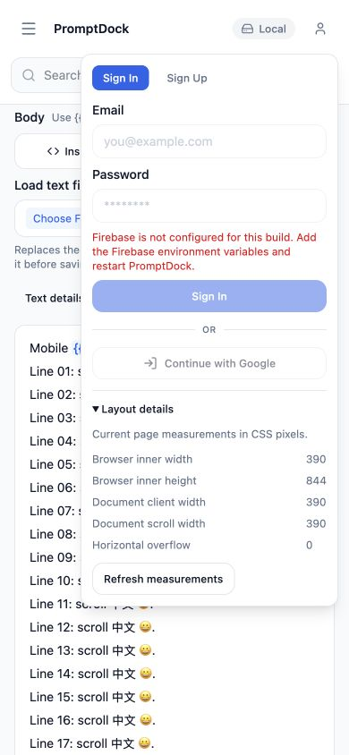

# Remaining runner obstacles — October 24, 2026

## Verified scope

This investigation did not start a TestSprite run, spend credits, save portal plan edits, alter fixtures/triggers/protection, or deploy application changes. The portal remains **107 cases / 217 assertions; 91 Passed / 2 Failed / 14 Blocked; 0 running**. Production and the remote PR head observed for this checkpoint remain `22647ec76670ae7401148f9cb6208c1982c681cb`. The Discord submission remains published.

## Concrete local correction: numeric layout measurements

The local application candidate adds **Account → Layout details** in the existing nonmodal Account popover. It reads actual `window.innerWidth`, `innerHeight`, `document.documentElement.clientWidth`, `scrollWidth`, and `max(0, scrollWidth - clientWidth)` in CSS pixels. Measurements refresh on demand, resize and DOM changes only while the details are open. There are no expected viewport constants, pass/fail flags, telemetry, storage, or root/body overflow-style changes.

The local browser readback at 390×844 was **390 / 844 / 390 / 390 / 0**. The regression compares visible readings with independent browser DOM values at two viewport sizes and injects real 970px-wide content: horizontal overflow must become **580px**, then return to zero after removal. This demonstrates that the panel reports actual layout rather than an expected result. The underlying long editor remains open and its draft remains usable.

[Pending TEM-010 actions](testsprite-layout-pending.yaml) use that panel in the library and saved long editor. Both assertions from the current saved portal baseline are verbatim; machine comparison preserves all 107 IDs/order, use-case and case metadata, and all 217 saved assertion strings. Only TEM-010 action steps differ from the saved baseline. **The pending plan is not saved in TestSprite and must not be applied before production deployment and verification.** No portal pass is claimed.

The first implementation passed lint, build, **1,055 Vitest tests / 13 existing emulator-dependent skips**, and **35 browser E2E tests**. Independent review then identified a short-height popover accessibility issue; the final available-height correction and its focused regression are recorded in the final verification section below. Real Firebase/cloud sync was not exercised.

## File obstacles: current account and UI evidence

- Account-info reports **Starter**. Current [official pricing](https://www.testsprite.com/pricing) lists **3 Test Files** for Starter and 10 for Standard.
- The project's Test Files page still lists all eight synthetic files as **Ready**. Opening Edit on the existing `ts4-valid.json` opens **“You've reached the Starter plan's test file uploads limit (8/3)”**, rather than metadata controls. No edit, deletion or upgrade was performed.
- Earlier probe `5cd14f34-63c3-4534-a573-53a270d29848` could access only `ts4-exact-12k.txt`, `ts4-long.json` and `README.md`. Matching the three-file quota is a concrete lead, not proof of why these three were selected or why the required files were absent.
- [Project Sources documentation](https://docs.testsprite.com/web-portal/setup/project-sources) describes plan-gated Test Files, but does not specify a per-run mount selector. No such selector was found in the inspected project UI. Retain all eight fixture records while support identifies a supported mechanism.

The app already provides a persistent visible **Choose JSON file** input and a standard Blob/anchor download. Independent browser regressions capture the real disk download, parse its complete JSON, and re-upload that same path twice. Displaying in-memory export JSON or reimporting it directly inside the app would not establish actual download/reimport correctness and is not used as a substitute.

| Outstanding file capability | Cases that require it |
|---|---|
| Actual download capture, byte inspection and reuse of the same file | JSN-001, FLT-015, FAV-011; also ONB-008, LIB-012, EDT-008 and TEM-008 |
| Named fixture availability for valid/modified/malformed/schema-invalid files | JSN-002/003/004/006, FLT-016/017, FAV-012/013; also the combined cases above |

Together these are the **14 blocked JSON cases plus failed FAV-011**. They remain unresolved in TestSprite.

## Replay and code-path findings

The current FAV-011 Code tab exposes generated Python/Playwright. Its inspected run clicked the old export/import controls and contains comments that the later checks were not verified; it does not demonstrate real download capture or reimport. Copying that code was read-only. No code was modified and no replay was launched.

[Run Behavior documentation](https://docs.testsprite.com/web-portal/setup/execution-settings) describes “Always use planned steps,” viewport settings and replay behavior. This project's inspected Run Behavior UI exposes login reuse, viewport (1920×1080 project default), concurrency (50) and Save Changes, but no planned-step toggle. No setting was changed. TEM-010's case-specific 390×844 override is separate from the project default.

The official [CLI reference](https://github.com/TestSprite/testsprite-cli/blob/main/DOCUMENTATION.md) makes stored-code replay workspace-dependent and marks V3 test-plan replacement unsupported. A Python Code tab does not by itself establish that this V3 project can execute a hand-edited `expect_download` / `save_as` / `set_input_files` sequence. That capability still needs confirmation; no CLI installation or new project was used to evade the existing suite.

## Existing support and next step

The Intercom conversation still shows **Waiting for a teammate**, with the support team expected back Monday. The [Discord escalation](https://discord.com/channels/1227394620623949934/1227394621362143326/1563460634979340358) already reports the download, fixtures, numeric measurements and PR-status mapping questions. A follow-up draft with the new quota evidence is prepared locally; it has not been sent.

Next, deploy the tested layout correction only after approval, verify production, then apply TEM-010's reviewed action-only change and run that one case once under an approved ceiling. For files, obtain a supported fixture/quota resolution and actual download-artifact workflow first; JSN-001 (download) and JSN-004 (named fixture import) are the smallest separate capability probes. Do not rerun all 16 cases without a concrete correction and approval.

## Final verification

After the short-height correction, **full lint and production build passed; 1,055 Vitest tests passed with 13 existing emulator-dependent skips; all 36 Chromium E2E tests passed**. The two layout cases cover 390×844, 1024×768 and a short 844×390 viewport, independently measured values, real overflow injection/removal, scrollable Account content, Escape dismissal and continued editor use. No new test retry was needed. The build retains the existing large-chunk warning; local auth startup still reports missing Firebase configuration. Cloud sync was outside this validation.

A fresh read-only portal YAML export semantically matched the existing saved snapshot. Comparing it with the full pending candidate again found only TEM-010 action changes and identical current case identities, metadata/order and 217 assertion strings. The portal editor showed No changes yet / disabled Save Changes and was exited with Done. The pending candidate was not applied.

Local browser screenshot of the real 390×844 measurements (sample draft, local build):

Local verification logs are `/tmp/promptdock-layout-final-lint.log`, `/tmp/promptdock-layout-final-build.log`, `/tmp/promptdock-layout-final-unit.log` and `/tmp/promptdock-layout-final-e2e.log`; these paths are local artifacts, not public links. Final portal status remains 91/2/14 and no cloud execution was started.
